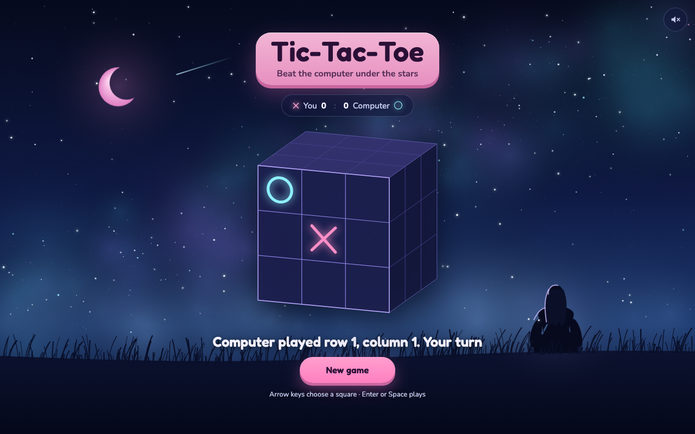

# Tic-Tac-Toe Under the Stars

[](https://github.com/2thinkcritical/CrosNnuls/actions/workflows/ci.yml) [](LICENSE)

**[Play it live](https://2thinkcritical.github.io/CrosNnuls/)**

Play X against a beatable computer on a rotating cube, under a night sky painted entirely in code. There is no framework, no build step and no image or audio files: just ES modules and the Canvas 2D API.



## Play locally

```sh
git clone https://github.com/2thinkcritical/CrosNnuls.git
cd CrosNnuls
python3 -m http.server 8080 --bind 127.0.0.1 --directory docs
```

Open http://127.0.0.1:8080. Click or tap an empty square, or Tab to the board and use the arrow keys; Enter and Space place your X. **New game** starts a fresh round and the score counts wins for the session. The speaker button in the corner turns on a short synthesized click. The game respects your system's reduced-motion setting.

The computer always takes a winning move or blocks yours, except when it deliberately slips: 30% of its moves are random, and it misses some wins and blocks on purpose, so it can be beaten.

## How it works

| Path | Responsibility |
| --- | --- |
| `docs/game.js` | Board controls, status announcements, turn scheduling, score and resets |
| `docs/rules.js` | Pure round transitions, winning lines and the computer opponent |
| `docs/geometry.js` | 3D rotation, 2D projection and the matching transform for the HTML grid |
| `docs/scene.js` | High-DPI Canvas rendering and animation of the cube |
| `docs/sky.js` | The night sky: Milky Way, moon, clouds, a stargazer on the hill, twinkling and shooting stars |
| `docs/audio.js` | Opt-in Web Audio tone synthesis |
| `docs/dom.js` | Typed lookup of required elements |
| `docs/fonts/` | Self-hosted Fredoka and Nunito variable fonts (SIL Open Font License) |

The front face is drawn in Canvas. An invisible HTML grid of buttons follows the same projection, so mouse, touch and keyboard all use the same nine accessible targets. The sky is generated from a fixed seed, so it looks the same on every visit.

## Verify

Requires Node.js 22.12+ and Python 3.

```sh
npm ci
npx playwright install --only-shell chromium
npm run lint
npm run typecheck
npm test
npm run test:browser
```

The code is plain JavaScript, type-checked in strict mode by TypeScript through JSDoc annotations (`checkJs`) and linted with ESLint. The Node suite checks round rules and projection alignment. The Playwright suite plays real rounds in headless Chromium: turn order, rapid resets, keyboard navigation, touch on high-DPI screens, short and narrow viewports, reduced motion and the sound toggle. CI runs everything on each push and pull request.
